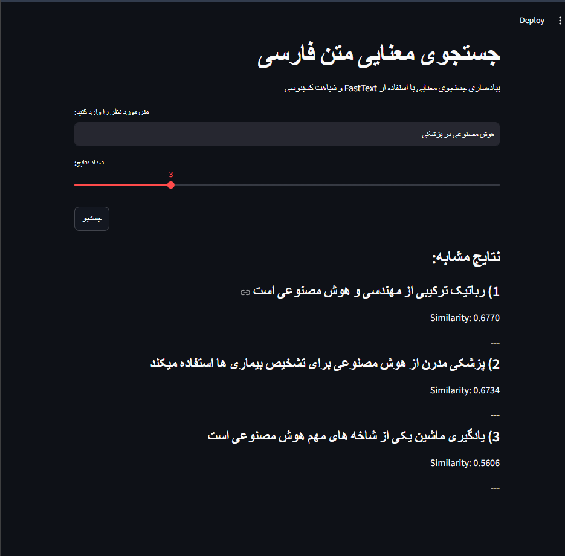
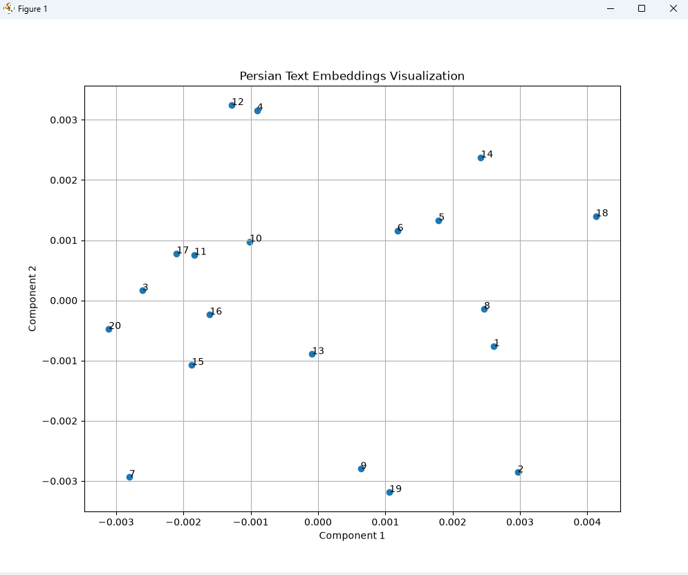

# Persian Semantic Search

[](https://www.python.org/)
[](https://opensource.org/licenses/MIT)
[](https://github.com/HamidNova/persian-semantic-search)

A Persian NLP project that compares **TF-IDF**, **SVD**, and **FastText** for semantic similarity and document retrieval. The project includes text preprocessing with Hazm, embedding visualization using PCA, and an interactive Streamlit search application.

---

# Features

- Persian text preprocessing with Hazm
- TF-IDF document representation
- Latent Semantic Analysis using SVD
- FastText sentence embeddings
- Cosine similarity search
- PCA visualization of embedding space
- Interactive Streamlit interface
- Method comparison between TF-IDF and FastText

---

# NLP Pipeline

```text
 Persian Text
      │
      ▼
Preprocessing (Hazm)
      │
      ▼
    TF-IDF
      │
      ├──────────────┐
      ▼              ▼
     SVD          FastText
      │              │
      └──────┬───────┘
             ▼
     Cosine Similarity
             │
             ▼
      Semantic Search
```

---

# Project Structure

```text
persian-semantic-search/

├── app/
│   └── streamlit_app.py
│
├── preprocessing/
│   └── cleaner.py
│
├── embeddings/
│   ├── tfidf_embedding.py
│   └── fasttext_embedding.py
│
├── dimensionality/
│   └── svd_reduction.py
│
├── similarity/
│   └── cosine.py
│
├── evaluation/
│   └── compare_methods.py
│
├── visualization/
│   └── plot_embeddings.py
│
├── data/
├── models/
├── outputs/
│
├── main.py
├── requirements.txt
└── README.md
```

---

# Technologies

- Python
- NumPy
- Pandas
- Scikit-Learn
- Hazm
- Gensim
- Streamlit
- Matplotlib

---

# Algorithms

- TF-IDF
- Singular Value Decomposition (SVD)
- FastText
- Cosine Similarity
- Principal Component Analysis (PCA)

---

# TF-IDF vs FastText

| Feature | TF-IDF | TF-IDF + SVD | FastText |
|----------|:------:|:------------:|:---------:|
| Keyword Search | ✅ | ✅ | ⚠️ |
| Semantic Understanding | ❌ | ⚠️ | ✅ |
| Handles Synonyms | ❌ | ⚠️ | ✅ |
| Dense Embedding | ❌ | ✅ | ✅ |
| Persian NLP | ⚠️ | ⚠️ | ✅ |

---

# Example Search

**Query**

```text
هوش مصنوعی در پزشکی
```

**Top Result**

```text
پزشکی مدرن از هوش مصنوعی برای تشخیص بیماری‌ها استفاده می‌کند.
```

Similarity

```text
0.6734
```

---

# Embedding Visualization

FastText generates 100-dimensional embeddings.

To visualize semantic relationships, embeddings are reduced to two dimensions using PCA.

Nearby points represent semantically similar Persian sentences.

---

# Screenshots

| Streamlit Search | PCA Visualization |
|--------------|-------------------|
|  |  |

---

# Installation

```bash
git clone https://github.com/HamidNova/persian-semantic-search.git

cd persian-semantic-search

pip install -r requirements.txt
```

---

# Usage

Run the complete NLP pipeline:

```bash
python main.py
```

Launch the interactive interface:

```bash
streamlit run app/streamlit_app.py
```

---

# Output Files

The project automatically generates:

- Trained FastText model
- Sentence embeddings
- Similarity report
- Comparison report
- PCA visualization

---

# Future Improvements

- Sentence Transformers (SBERT)
- BERT-based Persian embeddings
- FAISS vector search
- Hybrid retrieval
- Larger Persian datasets
- REST API for semantic search

---

MIT License

---

# Author

**Hamidreza Mirzaei**

Computer Engineering Student

GitHub: https://github.com/HamidNova